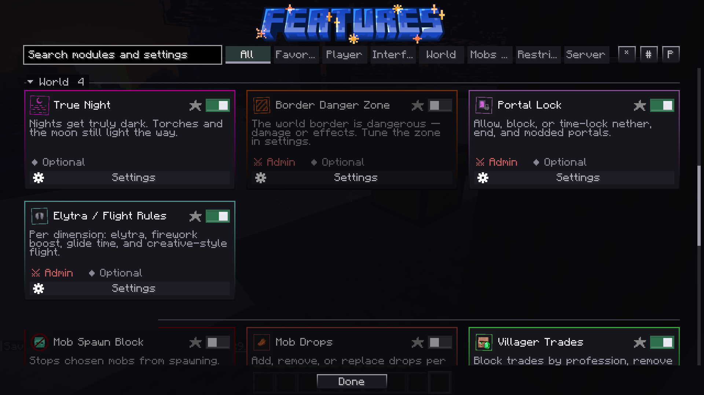
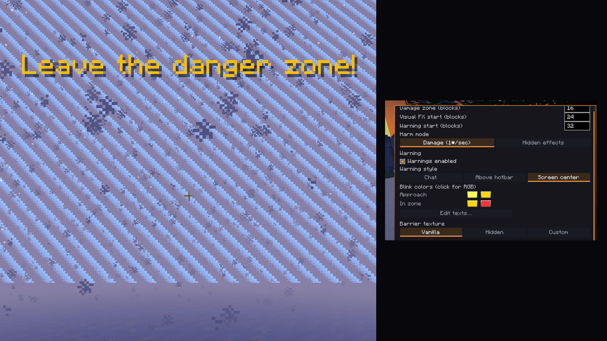

<h1 align="center">Features</h1>

<b>Toggleable gameplay modules for adventure maps and servers.</b>

<code>Minecraft 1.20.1</code> · <code>Forge</code> · <code>Client &amp; Server</code> · <a href="https://github.com/yab1oko/yblk-features"><code>GitHub</code></a>

---

## ✨ Overview

Features is a menu of modules you turn on only for the map or server you are building. Each module has its own settings. On a dedicated server the rules live on the server, and operator modules stay locked to operators.

## 🧩 Features

The menu groups modules into Player, Interface, World, Mobs, Restrictions, and Server. Search, favorites, and presets sit on the same screen.

**World.** True Night can be locked by an operator. Border Danger Zone warns, harms, and draws the world border, including the vanilla barrier texture. Portal Lock allows, blocks, or opens dimensions on an in-game day or a real date. Elytra and flight rules are set per dimension.

**Mobs.** Mob Drops adds, removes, or replaces loot per mob, with chance, count, and looting. Villager Trades blocks professions or the wandering trader, removes trades, and can freeze prices.

**Restrictions.** Command Blocker hides commands from tab-completion and denies them by role. Interaction Blocker stops opening, using, or breaking chosen blocks and entities. Tool Restrictions makes tagged blocks break only with the matching tool.

**Player.** Item Weight shows a load in the inventory and on tooltips, then slows you, stops sprinting, and burns hunger as the load climbs. Inventory Revamp, local chat, wetness, HUD hide, F3 hide, hide names, and real first person are still here.

**Server.** Server Tweaks covers a colored MOTD, a server-list icon, join and leave lines, rules, the tab list, kits, roles, mute, kick, ban, freeze, vanish, and a look at a player's inventory. Each anti-cheat check stays off until you enable it, and each one can log, tell operators, or kick.

Settings rows have a tooltip, a gold dot when a value left its default, and a Reset button for that screen's toggles and numbers. Lists on the right can be dragged.

## 🎮 How to use

Open the pause menu and click Features. Enable a module and open its settings. On a dedicated server, admin modules need operator permission.

## More mods by yab1oko

- [Cold Weapons](https://www.curseforge.com/minecraft/mc-mods/cold-weapons)
- [Custom Loot System (CTS)](https://www.curseforge.com/minecraft/mc-mods/custom-loot-system)
- [YBLK Fashion](https://www.curseforge.com/minecraft/mc-mods/yblk-fashion)
- [Roleplay Materials](https://www.curseforge.com/minecraft/mc-mods/roleplay-materials)

## Feedback

Bugs, balance notes, and ideas: join the Discord — [yab1oko mods](https://discord.gg/tXMBWwSuRp).
